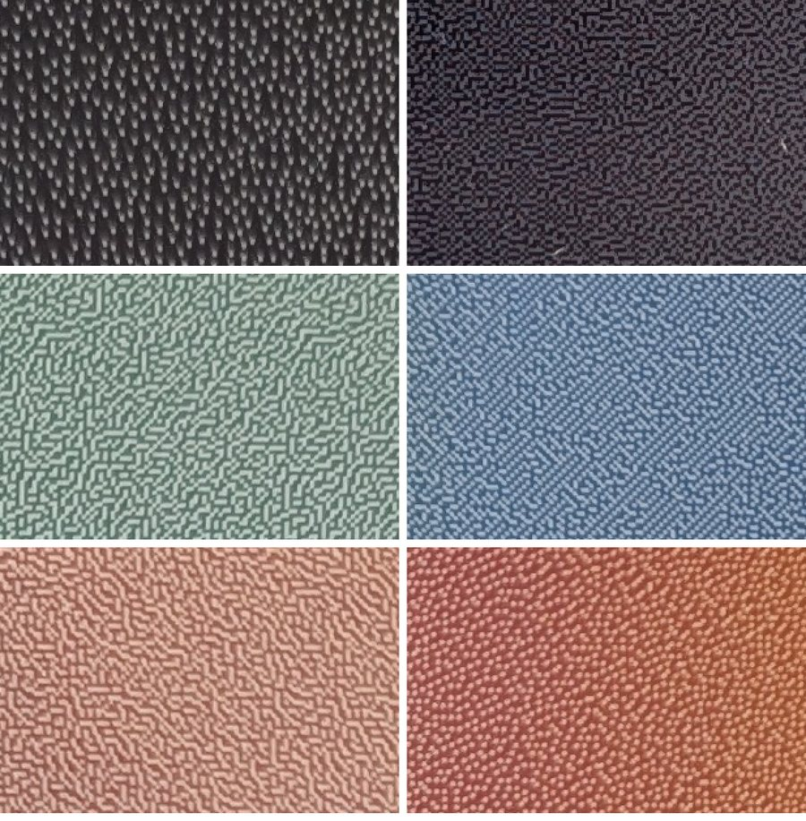

# EMDX photo frame

Every morning, this little service on the NAS picks a photo from a shared Google Photos album, crops it to the Samsung EMDX e-paper display, dithers it to the panel's six inks, and pushes it to the display. It also serves a small web page on the NAS where you can see what's on the frame (simulated), skip to the next photo, or send a test pattern.

It runs as a single Docker container. It was written for a Synology NAS (tested on a DS420+ with a 32" EM32DX hung in portrait), but any always-on Docker host on the same network as the display will do.

- **Shuffle without repeats:** every photo in the album is shown once before anything repeats. Photos added to the album later join the current round.
- **Odd shapes get paired:** on a portrait frame, landscape and square photos are shown two at a time, stacked, preferably two taken around the same time. Portrait photos fill the frame on their own, smart-cropped around the most interesting part.
- **The display does the final dithering:** the NAS crops, tones and sends the photo, and the panel's own algorithm turns it into ink dots. A NAS-side ditherer (gamut mapping plus blue noise) is included as `DITHER=local`, but on the EM32DX the panel's own processing looked clearly better side by side (see [Findings](#findings-nas-vs-panel-dithering)).
- **Sleeps between updates:** two minutes after each photo, the NAS powers the display off and checks that it went to sleep. By default its Wi-Fi listener stays on, so Wake-on-LAN can wake it any time; for weeks on a charge, deep sleep turns that off too (see [Sleep and battery](#6-sleep-and-battery)).
- **A week of photos at once (playlist mode):** with `UPDATE_MODE=playlist` the NAS sends the photos for the coming days as the display's own playlist, and the display changes the photo by itself every night while it stays in deep sleep. The NAS tops the playlist up whenever it finds the display awake (see [One photo a day from a playlist](#one-photo-a-day-from-a-playlist-update_modeplaylist)).

## 1. What you need

| | Where to find it |
|---|---|
| **Album share link** | Google Photos → the album → Share → *Create link*. It looks like `https://photos.app.goo.gl/…` (the full `https://photos.google.com/share/…?key=…` address works too). Anyone with this link can view the album. |
| **Display IP address** | Router or the Samsung E-Paper app. Give the display a fixed DHCP lease. |
| **Display MAC address** | Router/app. Lets the NAS wake the display from sleep (Wake-on-LAN). |
| **Display PIN** | The 6-digit device security PIN you set when configuring the display in the Samsung E-Paper app. |
| **NAS IP address** | DSM → Control Panel → Network. |

On the display (via the Samsung E-Paper app): set **Screen Orientation** to match how it hangs (`.env.example` assumes portrait). For deep sleep (`SLEEP_MODE=deep`, best on battery), also set its **Screen protection time** to the time of the daily update (see [Sleep and battery](#6-sleep-and-battery)). The NAS sets Network Standby, the Wi-Fi listener that Wake-on-LAN needs, at every update.

## 2. Install on a Synology NAS (Container Manager)

1. Copy this folder to the NAS, e.g. `/volume1/docker/emdx-photo-frame` (File Station, a mapped drive, or `git clone`).
2. In that folder, copy `.env.example` to `.env` and fill in `ALBUM_URLS`, `EMDX_HOST`, `EMDX_PIN`, `EMDX_MAC` and `SERVER_HOST`.
3. DSM → **Container Manager** → **Project** → **Create**. Choose the folder; it picks up `docker-compose.yml`. Let it build and start. The first build takes a few minutes. (Over SSH instead: `cd /volume1/docker/emdx-photo-frame && sudo docker compose up -d --build`.)
4. If the DSM firewall is on, allow TCP **8321** from your LAN. The display downloads each image from that port.

The container uses host networking and restarts automatically. Its state (which photos were shown, history), the current image and previews live in a Docker volume, `frame-data`, so updating by copying a new version of the folder over the old one keeps them. To start over, stop the project and delete the volume over SSH: `sudo docker volume ls` shows its name (ending in `frame-data`), and `sudo docker volume rm <name>` removes it.

## 3. First run

Open `http://<NAS-IP>:8321`.

1. Press **Show test pattern** and walk over to the display. The panel takes 20–50 s to redraw.
   - **"▲ TOP"** must be at the top and all four corner marks visible. If it is sideways or upside down, set `ROTATE=90`, `180` or `270` in `.env` and restart the project.
   - The **six swatches** should be the six inks.
   - The two sets of colour bands compare the NAS ditherer (`DITHER=local`) with the display's own processing (**"Smooth"**, the default `DITHER=device`). On an EM32DX the display's own looked better. If the NAS bands look better on your panel, set `DITHER=local`.
2. Press **Next photo now**.
3. With the default `SLEEP_MODE=standby`, check that the NAS can wake the display: over SSH, run `sudo docker exec emdx-photo-frame node src/index.js sleep-test`. It puts the display to sleep, waits until it stops answering, then wakes it with Wake-on-LAN and puts it back to sleep (about a minute when it works). With `SLEEP_MODE=deep`, check instead that `SCHEDULE` matches the display's screen protection time, and that **Check display** shows its clock right. In playlist mode, see [the first night](#the-first-night).

From then on it updates every day at 06:00 (`SCHEDULE`), and two minutes after each update the display goes back to sleep. If the display can't be reached at 06:00, it retries 3× at 20-minute intervals (in deep sleep the update waits for the display to wake itself instead). The web page shows whether the display is asleep (**Display**), what the half-hourly checks found (**Sleep checks**) and the battery at each update (**Recent**).

## 4. Try it on a laptop first (optional)

No display needed. Leave `EMDX_HOST` empty for a dry run:

```bash
cp .env.example .env    # set ALBUM_URLS
docker build -t emdx-photo-frame .
docker run --rm --env-file .env emdx-photo-frame node src/index.js check-album
docker run --rm -p 8321:8321 --env-file .env -e EMDX_HOST= -v "$PWD/data:/data" emdx-photo-frame
```

Then open http://localhost:8321 and press **Next photo now** a few times to preview the album. To render one of your own files: `docker run --rm --env-file .env -v "$PWD/data:/data" -v "/path/photo.jpg:/in.jpg:ro" emdx-photo-frame node src/index.js render /in.jpg`. The result lands in `data/render-test/`.

Other commands (`sudo docker exec emdx-photo-frame node src/index.js <cmd>` on the NAS):

- `check-album`: read the album and print what was found.
- `display-info`: connect to the display and print its name, battery, Network Standby, clock and timer 1. Changes nothing on the display.
- `sleep`: put the display to sleep now (Network Standby on, or off with `SLEEP_MODE=deep`; then power off) and wait until it stops answering.
- `sleep-test [minutes]`: check that Wake-on-LAN wakes the display from sleep, optionally after letting it sleep that many more minutes (see [Sleep and battery](#6-sleep-and-battery)).
- `playlist-test [minutes,…]`: the [playlist test](#can-the-display-switch-photos-by-itself-playlist-test), e.g. `playlist-test 10,20,20,20` (2 to 4 cards). Like `once`, only while the service is stopped; otherwise use the button.
- `once`, `test-pattern`: show the next photo (in playlist mode: send the playlist) or the test pattern. These start their own web server, so use them only while the service is stopped (e.g. with `docker run --rm`); while it runs, use the buttons on its web page.

## 5. Settings (`.env`)

| Variable | Default | |
|---|---|---|
| `ALBUM_URLS` | — | One or more share links, comma-separated |
| `PHOTO_DIR` | — | Extra source: a NAS folder mounted at `/photos` (see `docker-compose.yml`) |
| `PANEL` / `ORIENTATION` / `ROTATE` | EM32DX / landscape / 0 | EM13DX also known; or set `PANEL_WIDTH`/`PANEL_HEIGHT` |
| `SCHEDULE`, `TZ` | `0 6 * * *`, Europe/Brussels | Cron syntax. When the photo changes. With `SLEEP_MODE=deep` in push mode, use the display's screen protection time |
| `UPDATE_MODE` | push | `push`: the NAS sends a photo at every `SCHEDULE` time. `playlist`: the NAS sends the coming days at once and the display changes the photo itself (see [One photo a day from a playlist](#one-photo-a-day-from-a-playlist-update_modeplaylist)) |
| `PLAYLIST_DAYS` | 7 | Playlist mode: how many days ahead each playlist covers (1–60). See [how long a playlist](#how-long-a-playlist) |
| `PLAYLIST_TOPUP_DAYS` | 7 | Playlist mode: a fresh playlist goes out (when the NAS finds the display awake) only once fewer than this many days are left on it |
| `ODD_PHOTOS` | pair | `pair`, `crop` (smart-crop to fill) or `fit` (white margin) |
| `DITHER` | device | The display dithers. `local` dithers on the NAS instead (see [Findings](#findings-nas-vs-panel-dithering)) |
| `SATURATION`, `CONTRAST` | 1.0, 0.1 | Tone tweaks before sending. With `DITHER=local` the defaults are 1.3, 0.25 |
| `GAMMA`, `SHARPEN` | 1.0, 0.8 | Midtone lift and sharpening before sending |
| `DITHER_METHOD` | bluenoise | `DITHER=local` only. `diffusion` for classic error diffusion (`DITHER_KERNEL`: floyd-steinberg, stucki, jarvis, sierra, atkinson) |
| `PALETTE` | measured Spectra 6 | `DITHER=local` only. JSON of measured ink colours, if you photograph/measure your own panel |
| `OUTPUT_COLORS` | device | `DITHER=local` only. `measured` writes the measured RGB values into the PNG instead of pure colours |
| `SLEEP_MODE` | standby | After each update: `standby` (sleep, woken by Wake-on-LAN), `deep` (Network Standby off too; the display wakes itself at its screen protection time) or `off` (see [Sleep and battery](#6-sleep-and-battery)) |
| `WAKE_WINDOW_MIN` | 15 | `deep`: how long the scheduled update waits for the display to wake itself. Playlist mode: how long the NAS looks for the display after each change |
| `SLEEP_DELAY_SEC` | 120 | Time for the panel to redraw before it is sent to sleep |
| `SLEEP_CHECK_MIN` | 30 (playlist mode: 5) | Every this many minutes, check that the display is still asleep and put it back to sleep if not. In playlist mode this is also when the NAS tops up the playlist of a display it finds awake. `0` turns the check off |
| `WOL_BROADCAST`, `WOL_PORT` | 255.255.255.255, 9 | Where the Wake-on-LAN packet goes. Try your network's broadcast address (e.g. 192.168.1.255) if the display doesn't wake |
| `UI_PASSWORD` | — | Protects the web page (basic auth) |

## 6. Sleep and battery

E-paper keeps its picture without power, but a display that stays awake on Wi-Fi uses battery. So once the panel has redrawn (`SLEEP_DELAY_SEC`), the NAS powers the display off. How it sleeps depends on `SLEEP_MODE`:

- **`standby`** (default): Network Standby stays on, so the display's Wi-Fi keeps listening while it sleeps, and the next update or a button on the web page can wake it with Wake-on-LAN. On an EM32DX that costs about 1.5% of the battery an hour, so a charge lasts about three days, and on battery the display stops hearing Wake-on-LAN after many hours (see the findings below). Best when the display runs on USB-C power.
- **`deep`**: Network Standby off, then power off. The display then uses hardly any battery, but nothing on the network reaches it. It does wake itself once a day at its **screen protection time** (Samsung E-Paper app → the display → Screen protection time), when it refreshes the panel. Set `SCHEDULE` to that same time: the update then looks for the display for up to `WAKE_WINDOW_MIN` minutes (default 15), without Wake-on-LAN, sends the photo and puts it back into deep sleep. During the day the buttons on the web page reach the display only after someone has pressed its power button.
- **`off`**: leaves sleeping and Network Standby to the display's own settings ("Sleep After" in the app).

The display may also go to sleep by itself before the NAS gets to it ("Sleep After"), so the NAS sets Network Standby during every update (on for `standby`, off for `deep`), not just when it sends the display to sleep.

**Making sure it sleeps.** An awake display keeps using its battery, so the NAS doesn't stop at sending the power-off command. It waits until the display stops answering (up to 2.5 minutes). If it still answers, the NAS sends it to sleep once more, and if that fails too, the web page says so in red. Every `SLEEP_CHECK_MIN` minutes (default 30) the NAS also checks that the display is still asleep, for example after someone pressed its power button. If it is awake and a photo is still waiting to be shown (the display slept through its update), the NAS sends the photo; otherwise it puts the display back to sleep. The page lists when it was found awake. These checks don't wake a sleeping display: they only try to connect, without sending Wake-on-LAN. They pause in the 20 minutes before a scheduled update, so that a display that woke itself for the update isn't sent back to sleep.

Samsung quotes up to 70 days per charge in sleep mode and up to 80 days in deep sleep, with one update a day ([product page](https://www.samsung.com/au/business/smart-signage/others/color-e-paper-emdx-a-lh32emdiagbxxy/), pre-release lab tests).

`sleep-test [minutes]` checks the Wake-on-LAN setup for `standby`: it puts the display to sleep with Network Standby on, waits until it stops answering plus the given minutes, then wakes it with Wake-on-LAN.

### Findings: sleep and wake-up on an EM32DX

Tested in October 2026 on an EM32DX (firmware S-RSEDWWC-1130.7) on 5 GHz Wi-Fi:

| What | Result |
|---|---|
| Wake-up timer (MDC `0x25`, listed as an on-timer in some notes) | Refused (NAK). On Samsung's other screens `0x25` is brightness. |
| Deep sleep (Network Standby off), then Wake-on-LAN | Woke it half a minute after it fell asleep, not seven hours later. |
| Sleep with Network Standby on, then Wake-on-LAN | Woke it within seconds after 5, 15, 30 and 60 minutes and after 5 hours asleep, and at 06:00 after two nights (one of them on the charger). Twice, after a night and after a full day asleep on battery, it didn't wake, nor in the hour after. |

- **Battery in standby:** with Network Standby on, the reading dropped about 1.5 percentage points an hour (100% to 92% in the five hours after an update). After the full day at the end of which Wake-on-LAN no longer reached it, it still read 100%. So on battery the display seems to drop into a deeper sleep after many hours, with its Wi-Fi off. Guides for signage software describe the same: on battery the display enters deep sleep after a period of inactivity and is then offline until it is woken from the Samsung app or connected to power ([NowSignage](https://knowledgebase.nowsignage.com/samsung-e-paper-setup-nowsignage-installation-guide)), and Network Standby "may consume additional power" ([OnSign](https://onsigntv.helpjuice.com/en_US/installing-samsung-e-paper)).
- **Bluetooth:** Samsung's E-Paper app monitors the display over Bluetooth and can wake it. The NAS has no Bluetooth, which is why `deep` relies on the display waking itself.

The sleep commands (MDC `0x11` power, `0xB5` Network Standby) follow the EMDX command notes in [taylorRichie/node-samsung-emdx](https://github.com/taylorRichie/node-samsung-emdx/blob/main/docs/MDC-COMMANDS.md).

### One photo a day from a playlist (`UPDATE_MODE=playlist`)

Deep sleep saves the battery, but then the NAS can't reach the display to send the next photo. Playlist mode turns this around: the display changes the photo itself. Samsung's E-Paper app works the same way with its playlists, and the [playlist test](#can-the-display-switch-photos-by-itself-playlist-test) showed how the display times them: it starts with the first photo, and shows each photo for its own duration, counted from when it got the playlist.

- **What the NAS sends:** one playlist with the photo for now, shown until the next `SCHEDULE` time, then one photo per change for `PLAYLIST_DAYS` days (default 7). The durations follow the real change times, so a photo shows for 23 or 25 hours across a daylight-saving switch. If no fresh playlist arrives in time, the display starts over at the first photo; an extra item at the end keeps the changes on time then too.
- **When:** the NAS renders the photos ahead and keeps `PLAYLIST_DAYS` ready. It sends a fresh playlist when it finds the display awake and fewer than `PLAYLIST_TOPUP_DAYS` (7) days are left on it (with the default 7-day playlist: whenever a day has passed), or when something changed, like **New photo for today**. It looks every `SLEEP_CHECK_MIN` minutes (default 5 in this mode), without Wake-on-LAN, so pressing the display's power button is enough: within a few minutes it gets a fresh week (**Check display** right after the button press does it at once). Each fresh playlist starts with the photo it already shows, so the frame keeps its photo until the next change.
- **Sleep:** with `SLEEP_MODE=deep` the NAS switches Network Standby off and powers the display off after each playlist, as after any update. Pick a `SCHEDULE` time that differs from the display's screen protection time, so you can tell the two apart.
- **After each change** the NAS looks for the display for `WAKE_WINDOW_MIN` minutes. If it comes online by itself after a change, it gets a fresh playlist then. In deep sleep it most likely changes the photo offline.
- **On the page:** the **Playlist** tab shows the photos for the coming days. The outlined one should be on the frame now. **On the frame** follows the playlist, and **Seen on the display** shows what the display's own thumbnail showed whenever the NAS could ask for one (if the firmware sends thumbnails). **New photo for today** replaces the photo for now; **Send playlist** sends the playlist now (press the display's power button first).
- A test pattern replaces the playlist until the next fresh one. After a playlist test, the NAS sends the playlist again.

#### How long a playlist?

`PLAYLIST_DAYS` sets it, up to 60. Every photo goes to the display as a full-colour PNG at panel size, typically 2–4 MB (2 MB for a smooth photo, 3.4 MB for a detailed test image; the log shows each one as the display downloads it). So 30 days come to roughly 60–130 MB per playlist. The display has 8 GB of storage, so that is no limit. What costs battery is the download: the display's Wi-Fi is on for as long as it takes. Changing the photo from its own storage needs no Wi-Fi.

A longer playlist therefore saves battery, provided the NAS doesn't send it again at every chance. That is what `PLAYLIST_TOPUP_DAYS` is for: with `PLAYLIST_DAYS=30` and the default 7, the NAS sends a fresh playlist only in the last week, so once every three weeks or so, the next time it finds the display awake (press its power button now and then). If it never does, the playlist starts over, on time. **Recent** on the page lists the battery at each playlist, so you can see what a download costs. On the NAS each planned photo takes about 5–10 MB in the data volume.

#### The first night

Set `UPDATE_MODE=playlist` and `SLEEP_MODE=deep`, restart, and press the display's power button. Within `SLEEP_CHECK_MIN` minutes the log says `Playlist: the display has it`, and **Playlist** on the page shows when it was sent. The next morning the frame should show the photo outlined in the **Playlist** tab, the one for that day. If it still shows yesterday's, the display doesn't change photos in deep sleep: please open an issue with the log around the change time.

### Can the display switch photos by itself? (playlist test)

Samsung's E-Paper app can send a playlist: one download with several images, each with its own display time, which the display then plays without the phone. If the display keeps doing that in deep sleep, the NAS could send weeks of photos at once and leave the display in deep sleep in between. The playlist format comes from Samsung's Android app (decompiled): the same JSON schedule this service already sends, with several images in it, each with a `duration` in milliseconds (the app's "24 h" interval is 86400000). How the display counts those durations isn't in the app, so this test measures it.

**Run it** during the day, with the display on USB-C power: wake the display (press its power button if it is in deep sleep), open the web page and press **Playlist test**. It takes about an hour and a half:

1. The NAS notes the display's Sleep After, "apply sleep mode after content update" and Network Standby settings, then keeps it awake for the test.
2. It sends four numbered cards (red, yellow, green, blue) as one playlist, to show for 10, 20, 20 and 20 minutes.
3. Every 2 minutes it asks the display for a thumbnail of its screen (MDC `0xC7`/`0x54`, as Samsung's app does) and notes which card is up. The thumbnails stay in the data volume (`playlist-test/`); the page links the latest ones.
4. It then works out how the display timed the playlist: counted from when it received it, from midnight, or from 1970 without restarting, and with each card's own duration or the first card's for all. The verdict appears under **Playlist test**.
5. Finally it puts the display's settings back and sends your photo again, which ends the playlist. **Stop test** ends it early, with the same clean-up.

If no thumbnails come back (the firmware may not support them), the verdict says so; then watch the panel instead. Card 1 comes first. Counted from the push, card 2 follows 10 minutes later, card 3 after 30, card 4 after 50 and card 1 again after 70.

**Result on an EM32DX** (firmware S-RSEDWWC-1130.7, on USB-C power, October 2026): the display played the playlist by itself, each card for its own duration, counted from the push. Card 2 came 11 minutes after the push and card 3 after 31, each about a minute late (probably the time it takes to draw the first card). Timed from midnight, they would have come at 14:10 and 14:30 in that run, against 14:08 and 14:28 seen. No thumbnails came back.


**Check display** now also shows Sleep After, "sleep after content update" and whether the display has a low-power Wi-Fi module, and asks the display for a thumbnail of its screen, linked under **Screen**.

## 7. How it works

1. **Album.** Google closed the Photos Library API for existing albums in March 2025. The official alternatives are the Picker API (pick by hand) and the Ambient API (partner program only). So this reads the album the way its public web page does: the first page of items is embedded in the HTML, and later pages come from the same endpoint the page uses. This is unofficial and may break if Google changes the page. The last good list is cached, so the frame keeps going meanwhile. Videos are skipped.
2. **Crop/layout.** libvips' attention-based smart crop (sharp) is used, with EXIF orientation honoured. Pairs split the frame in proportion to the photos' shapes, so both lose about the same amount.
3. **Tone.** Gentle auto-levels, an S-curve and (optionally) a saturation boost are applied in Oklab.
4. **Dither.** By default the NAS sends the toned photo as a PNG at the panel's native resolution and the display dithers it. With `DITHER=local` the NAS does it instead:
   - *Gamut:* the image's white and black are mapped to the paper white and ink black. Colours the inks can't make are pulled toward grey until they fit inside the convex hull of the six measured ink colours, which is everything dithering can reproduce.
   - *Dither:* each colour is written as an exact mix of at most five inks: a grey from black and white, plus the hull face around its hue. A 64×64 blue-noise mask then picks one ink per pixel in those proportions. The PNG uses pure colours (#FF0000 etc.); the web preview uses the measured colours.
5. **Push.** The NAS sends Wake-on-LAN (in deep sleep it waits for the display to wake itself instead), connects with Samsung MDC (TLS + PIN) and sends command `0xC7` with a URL. The display then downloads a small JSON schedule and the PNG from this container. This trick comes from [node-samsung-emdx](https://github.com/WeeJeWel/node-samsung-emdx), and the MDC client from [@weejewel/samsung-mdc](https://github.com/WeeJeWel/node-samsung-mdc), both by Emile Nijssen.

## 8. Troubleshooting

- **"accepted the command but never downloaded"**: the display can't reach `http://SERVER_HOST:HTTP_PORT`. Check `SERVER_HOST`, the DSM firewall, and that the display and the NAS are on the same network.
- **"Incorrect PIN"**: check `EMDX_PIN`. After several wrong PINs the display may block MDC for a while.
- **Is the display reachable, and how is it set?** The web page's **Check display** button wakes it and shows its battery, firmware, Network Standby, clock and timer 1 (Samsung's standard MDC on/off timer, read only). `display-info` does the same on the command line. In deep sleep, press the display's power button first.
- **"did not wake by itself within … minutes"** (`SLEEP_MODE=deep`): the display's screen protection time and `SCHEDULE` must match, and its clock must be right (**Check display** shows it). Press the display's power button, then **Send again** to show the photo now.
- **"Fresh playlist due"** (playlist mode): the display needs a new playlist but the NAS hasn't found it awake yet. Press its power button; within `SLEEP_CHECK_MIN` minutes the NAS sends it. Until then the display keeps playing the playlist it has, and starts over when it runs out.
- **"Could not connect"**: the display is asleep or offline. Set `EMDX_MAC` for Wake-on-LAN, check its battery, run `sleep-test`, try `WOL_BROADCAST` set to your network's broadcast address, or raise `WAKE_WAIT_SEC`. If it fell asleep while Network Standby was off, Wake-on-LAN can't reach it: press its power button and send a photo, which switches Network Standby back on.
- **"The display did not go to sleep"**: it took the power-off command but kept answering, so it is using battery. The NAS tries again at every sleep check (`SLEEP_CHECK_MIN`). If it keeps failing, the log shows each try; please open an issue with it.
- **"the display refused MDC command …"**: this firmware doesn't support that command. Please open an issue with the full message.
- **Album errors**: run `check-album`. If it fails while the link opens fine in a browser, Google probably changed the page format. The frame keeps using the cached list in the meantime.
- **Photos too dark or flat on the panel**: try `SATURATION=1.15`, `CONTRAST=0.2` or `GAMMA=1.15`.

Logs: Container Manager → Container → emdx-photo-frame → Log.

## Findings: NAS vs panel dithering

The test pattern shows the same colour bands twice: dithered on the NAS, and left to the display. Zoomed in on a phone photo of an EM32DX (left: NAS, right: panel; rows: dark grey, green/blue, red/orange):



- **Colour:** the panel trades lightness for saturation. It shows a real orange, a dark green and an actual blue, where the NAS version keeps the original lightness and comes out pale (salmon, grey-teal, hardly any blue).
- **Texture:** in dark greys the NAS mixes only black and white, which leaves bright specks on black. The panel mixes black with blue, a much quieter texture.
- **Brightness:** the two grey ramps are about equally bright, and the display shows the NAS image pixel for pixel (the blue-noise pattern is visible). So the difference is the algorithm: Samsung's is tuned to its own inks.

Beating it on the NAS would take a chroma-preserving gamut mapping, low-contrast ink pairs for dark tones, and calibration against photos of the panel.

## Credits

The measured palette comes from [epdoptimize](https://github.com/paperlesspaper/epdoptimize). The album item format follows [google-photos-album-image-url-fetch](https://github.com/yumetodo/google-photos-album-image-url-fetch) and [gphotos-scraper](https://github.com/jmsalazardev/gphotos-scraper).

## Development

```bash
npm install
npm test     # unit tests + an end-to-end run against a fake EMDX and a mock album (needs openssl)
```

## License

MIT, see [LICENSE](LICENSE). Not affiliated with Samsung or Google.
