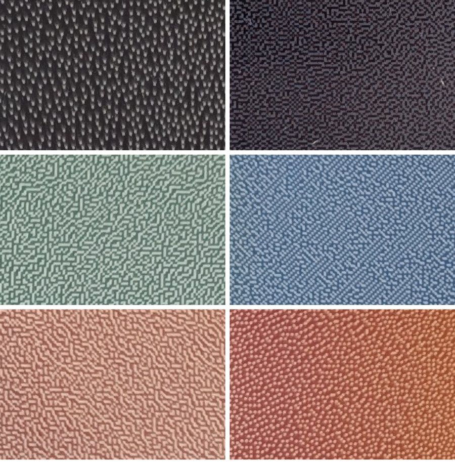

# Findings: a Samsung EM32DX on battery

What we learned while building this, in October 2026, on one EM32DX (not the -A model), firmware S-RSEDWWC-1130.7, on battery and on USB-C power, on 5 GHz and later 2.4 GHz Wi-Fi.

## The display plays playlists by itself

Samsung's E-Paper app (Android 1.3.3, decompiled) sends a playlist as the same JSON manifest as a single photo, with several images in one schedule entry, each with its own `duration` in milliseconds. The display downloads all of them at once.

- **Timing** (four test cards of 10, 20, 20 and 20 minutes, on USB-C power): the display starts at the first card straight away, shows each one for its own duration counted from the push, and starts over after the last. Counted from midnight, the changes would have come at other times. Each visible change came about a minute after push + duration, probably the time the panel takes to draw.
- **In deep sleep** (network standby off, nights of 18 and 19 October): it still changes the photo at the right time, and comes online about 10 seconds after each change, long enough for the NAS to send it a new playlist; within a few minutes it was back in deep sleep by itself. The NAS uses that moment to read the battery and, when needed, send the next playlist, so playlist mode needs no button presses.
- **Leave it alone around a change** (21 October): the photo did not change at 06:00. That morning the NAS had found the display awake at 05:02 and at 05:57 (probably its daily screen protection refresh, set to 05:55) and sent it to sleep both times, and at 06:00 sent it to sleep again within seconds of it coming online. On the mornings before, the NAS had not caught it awake before the change, and after the change it had either sent a playlist or waited about 10 s (for a thumbnail) before the power-off command. Since then the NAS sends no power-off command from 15 minutes before a change until 15 minutes after, nor right after a change.

## Sleep and wake-up

| What | Result |
|---|---|
| Network standby on (sleep mode), then Wake-on-LAN | Woke within seconds after 5, 15, 30 and 60 minutes, and after 5 hours asleep. Twice it didn't, after a night and after a full day on battery. |
| Network standby off (deep sleep), then Wake-on-LAN | Woke half a minute after it fell asleep, not 7 hours later. |
| Battery | About 1.5% an hour with network standby on (100% to 92% in 5 hours). Next to nothing in deep sleep (still 100% after a day). |
| Left alone after a change, 26 October (no power-off command, no update) | It came online for the change (05:58) and then stayed on the Wi-Fi for 2 days 10 hours, at about 1.7% battery an hour (97% to 16% in two days), until the battery ran out and the photo stopped changing. On 23 October, after a change just like it, it had gone off the Wi-Fi within 20 minutes. So the display can end up in a light sleep by itself; the service now notices that and puts it into deep sleep. |
| Power-off command (network standby off) seconds after a change, 20 October | It stopped answering MDC but stayed on the Wi-Fi: the router showed it connected for more than two days, and the battery went down about 1.7% an hour (100% to 18% by 22 October), as in a light sleep. It came online at once after the next changes (before: 10 s, to reconnect). On the nights before, it had gone to sleep by itself after an update and was off the Wi-Fi until the next change. |
| Wake-up timer, MDC `0x25` (listed as an on-timer in some notes) | Refused. On other Samsung screens `0x25` is brightness. |
| Screen protection time (a daily panel refresh set in the app) | Didn't bring the display onto the network (one test). See also *The daily panel cleaning* below. |
| Low-power Wi-Fi module (the app's remote wake-up on the EMDX-A, MDC `0xCB`) | Not present. |

From the NAS this shows in how a connection attempt fails: to a display that is off the Wi-Fi, with "host unreachable" (nothing answers its address); to one in a light sleep, by timing out (17 October). The service now tells the two apart on its page.

Guides for signage software describe the same behaviour: on battery the display enters deep sleep after a while and is then offline until it is woken from the Samsung app or plugged in ([NowSignage](https://knowledgebase.nowsignage.com/samsung-e-paper-setup-nowsignage-installation-guide)), and network standby "may consume additional power" ([OnSign](https://onsigntv.helpjuice.com/en_US/installing-samsung-e-paper)). Samsung quotes up to 70 days per charge in sleep mode and up to 80 in deep sleep, with one update a day ([product page](https://www.samsung.com/au/business/smart-signage/others/color-e-paper-emdx-a-lh32emdiagbxxy/)).

## The daily panel cleaning

The display cycles its panel through its colours once a day, at its *screen protection* time (set in the Samsung app, MDC `0x1B`/`0xB0`; it can be moved but not switched off). Where that time sits matters on battery:

- **Just before the change** (05:55, 17 to 23 October): the display came online right after the 06:00 change every morning (the one morning the photo didn't change, the NAS had sent it to sleep at 05:57).
- **At night** (around 04:45, then 02:00, 24 October to 8 November): it mostly slept through the morning change. It came online after the change on 26 October and on 2 and 5 November, but not on 24 October and 3, 4, 6, 7 and 8 November; a press on its power button brought it back each time, often with the right photo. On 24 October the cleaning itself hung: the panel stayed solid yellow from about 04:45 and the display was off the Wi-Fi all night. The NAS had not been in touch with it on any of those nights, and the battery was 91–100%.

The likely reading: after a cleaning at night the display sometimes goes back to sleep without its wake-up for the next playlist change (or hangs in the cleaning), whereas a cleaning just before the change leaves it awake when the change comes. The cleaning seems to take a few minutes (the router once saw the display on the Wi-Fi for 5 minutes during one). The service leaves the display alone around the cleaning, and after a missed change sends a fresh playlist as soon as the display answers again.

## Other MDC behaviour

- **Thumbnails of the screen** (MDC `0xC7`/`0x54` + a URL, as the app asks for them): the display accepts the request but has never sent one, on any path of the NAS's server at port 8321. Samsung's app (1.3.3) asks with `http://<phone>:6868/device-thumbnail` (its own web server, plain HTTP) after reading the battery; the display then POSTs a multipart form (the image, `device_id`, `content_id`, `content_name`, content and player type, download and thumbnail timestamps). For a playlist `content_id`/`content_name` are the playlist's, not the photo's, so only the image tells which photo it shows. Since 8 November 2026 the service listens on port 6868 too and asks there (untested on the panel yet); it stops asking after three unanswered tries at the same address.
- **Download progress**: the display POSTs JSON reports to `/content-transfer-progress` on the host and port it downloads from.
- **"Apply sleep mode after content update"** (`0xC7`/`0x53` type `0x01`) and **Sleep After** (`0xC6`/`0x81`) can be read and set. This service leaves both as set in the app.
- **Deep sleep has no command of its own.** The Samsung app's *Sleep* button ("the device will enter deep sleep mode") sends `0x11 00`, the same power-off this service uses; choosing *Deep sleep mode* sends network standby off (`0xB5 00`) and Sleep After. How deeply the display sleeps is up to its network standby setting.
- The display drops answers when commands follow each other faster than about 300 ms.

## Dithering: the NAS or the panel?

The test pattern shows the same colour bands twice: dithered on the NAS, and left to the display. Zoomed in on a phone photo of the panel (left: NAS, right: panel; rows: dark grey, green/blue, red/orange):

- **Colour:** the panel trades lightness for saturation: a real orange, a dark green and an actual blue, where the NAS version keeps the original lightness and comes out pale.
- **Texture:** in dark greys the NAS mixes only black and white, which leaves bright specks on black. The panel mixes black with blue, a much quieter texture.
- **Brightness:** the two grey ramps are about equally bright, and the display shows the NAS image pixel for pixel. So the difference is the algorithm: Samsung's is tuned to its own inks.

Beating it on the NAS would take a chroma-preserving gamut mapping, low-contrast ink pairs for dark tones, and calibration against photos of the panel. Hence `DITHER=device` by default.
